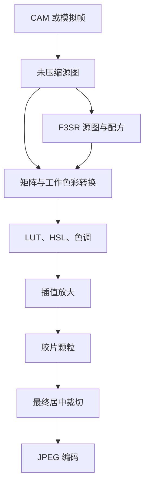

# 架构

`source/platform` 管理 3DS CAM、Y2R、PICA200 渲染、触摸与 SD 路径。`source/ui` 保存取景、胶卷和暗房三页的纯 C 状态。`source/camera` 提供可复现的模拟帧。`source/color`、`source/image` 和 `source/storage` 分别处理色彩、缩放裁切与文件。各输入对象借用缓冲区，分配或读入成功后输出对象由调用者释放。调用方使用空输出对象，并在替换前释放旧对象。

YUYV 保留 CAM 原字节。CPU 用浮点将 Cb/Cr 对共享像素转成 RGB，BT.601/BT.709 矩阵与全／有限范围分别可选。默认 601 全范围属于待校验的相机工作假设。转入 sRGB 工作值也依赖 CAM 的实机色彩校准。RGB565 小端按 5/6/5 展开。曝光在线性光域计算，LUT 的输入与输出传递函数分别声明，映射结果转换回工作空间后按强度混合，随后进行全局及分区 HSL。色相区以 0°、30°…330° 为中心，跨 360° 连续插值。无色相像素只受全局明度调整。

冲洗时将 LUT 前曝光和暗房 Post-LUT EV 分开。LUT 混合后的线性亮度依次经过 Toe、黑点／中间调／高光曲线和 Shoulder，再应用 HSL。暗房饱和度缩放线性 RGB 的色度，输出色域限制沿固定亮度收回超范围色度。普通同传递函数的色表在定义域边界内采样，用相邻格的斜率保留边界外的输入余量。带输入整形或输入、输出传递函数不同的色表沿用各自的边界采样。

调色结果量化为 RGB888，插值使用像素中心坐标和边缘复制。双三次采用 Catmull–Rom。原生尺寸跳过插值。颗粒以配方种子生成可复现的亮度噪声。裁切在放大画布上逐行原地压紧，内存分配仍保留放大后的容量。VGA 2× 时源图约 0.59 MiB、调色 RGB 约 0.88 MiB、放大 RGB 约 3.52 MiB、65³ LUT 样本约 3.14 MiB。估算只计算对应缓冲区，系统和 JPEG 编码器的峰值由实机测量。

## F3SR v1、v2 和 v3

每张照片一个 `.f3s` 文件。整数均为小端，浮点数为 IEEE 754 binary32。原始像素逐行紧密排列，无填充。

| 字节偏移 | 内容 |
| --- | --- |
| 0 | 4 字节魔数 `F3SR` |
| 4、8、12 | 32 位版本、304 字节头长度、像素负载长度 |
| 16、20、24 | 32 位宽、高、像素格式。1 为 YUYV，2 为 RGB565_LE，3 为 RGB24 |
| 28 | 64 位 Unix 秒，0 表示未知 |
| 36、40、44 | 32 位曝光微秒、ISO、相机标识。曝光与 ISO 为 0 表示未知，标识 0 为模拟，1 为单外摄 |
| 48–51 | 各 1 字节，依次是画幅、档位、插值核、YUV 矩阵范围组合，取值顺序见 `include/film.h` |
| 52、56、60 | 32 位颗粒种子、浮点颗粒强度、32 位 JPEG 品质 |
| 64–127 | 64 字节零终止 LUT 标识，未选时为空 |
| 128–299 | 172 字节色彩配置 |
| 300–303 | IEEE CRC-32，覆盖头的前 300 字节及完整像素数据 |
| 304 起 | 未压缩相机像素 |

有饱和度调整时写入 v2。v2 在偏移 300 处存储相对饱和度（浮点数，−1 至 +1），CRC 移到偏移 304 并覆盖头的前 304 字节和像素，未压缩像素从偏移 308 开始。读取 v1 时基础饱和度默认为 0。

暗房影调有非零设置时写入 v3。偏移 304–331 依次存储 Post-LUT EV、黑点、中间调、高光、Shadows、Shoulder 和暗房饱和度。CRC 位于 332–335，覆盖前 332 字节及原始像素。像素从偏移 336 开始。v1、v2 读取时所有暗房影调参数默认为零。

输出宽高由头中的原始尺寸、画幅和档位确定。记录所选 LUT 的标识和配置，LUT 文件由用户另行保管。重复使用同名 LUT 时，调用方负责核对文件内容。长度、版本、取值、完整性或尾随数据异常都会报错。写入先创建同目录临时文件，关闭成功后重命名。掉电和 SD/FAT 的持久性另行测试。

## F3PR v1

独立色彩配置总长 184 字节。魔数 `F3PR`，接 32 位版本和 172 字节配置，最后是覆盖前 180 字节的 CRC-32。配置由 32 位输入与输出传递枚举、浮点强度和 EV、全局 HSL 及 12 组分区 HSL 构成。每组为色相偏移度数、相对饱和度、绝对明度偏移。

`tools/profile.py` 从 JSON 生成配置，支持 `strength`、`exposure`、`global` 和 `zones`。色相偏移范围 ±180°，饱和度和明度偏移范围 ±1，LUT 前曝光范围 ±8 EV。`.f3p` 强度是暗房首次选中色表时的默认值。实际混合使用滑块值。
